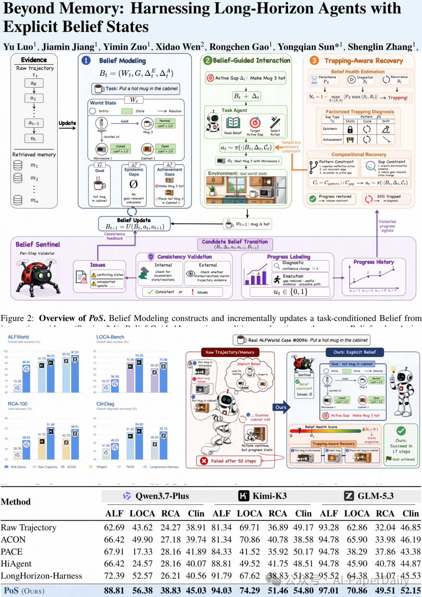
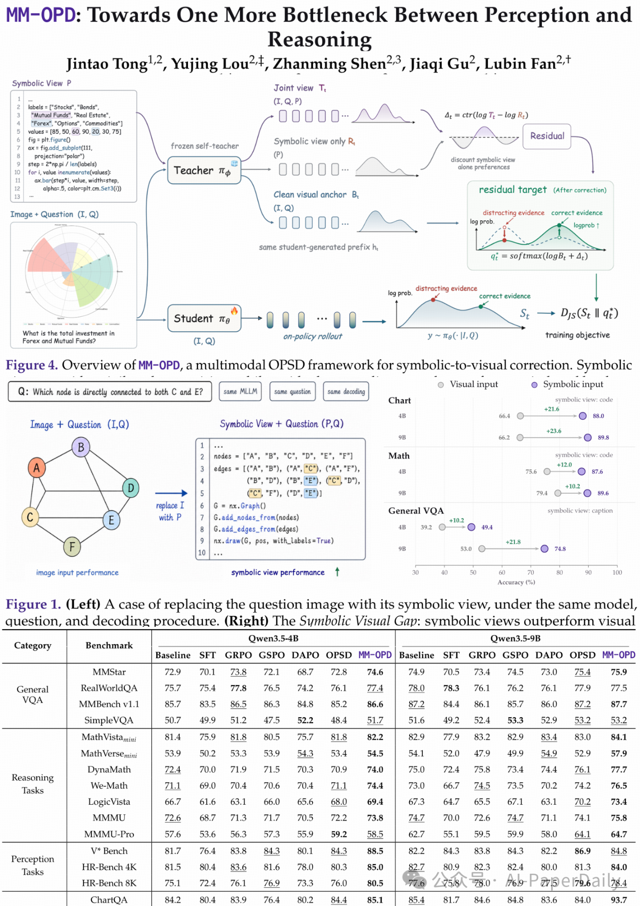
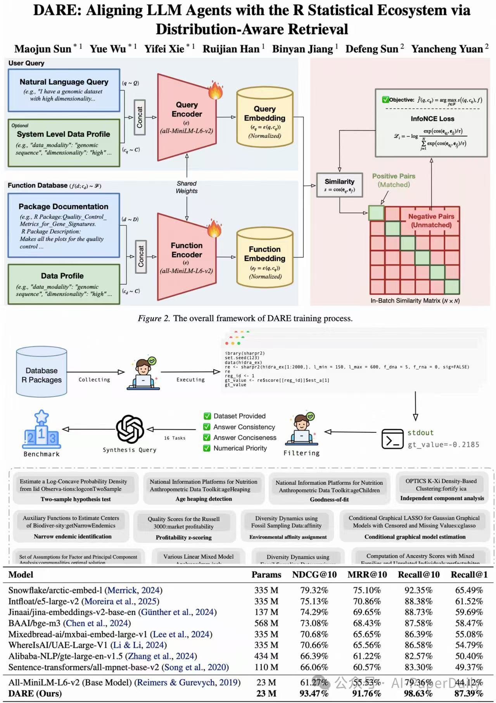
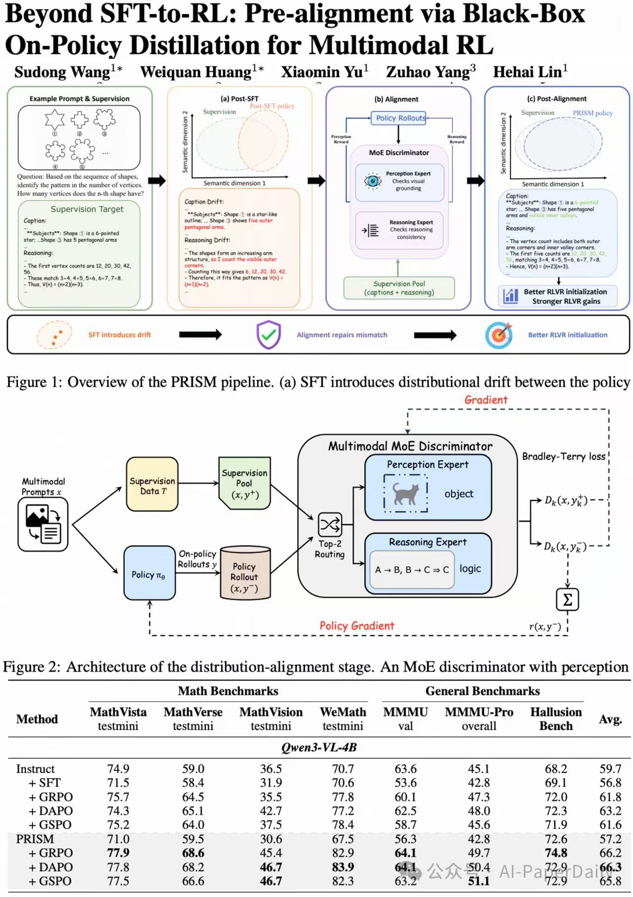

# 绘图参考图库 / Plotting Reference Gallery

本目录收录用户从资料库上传的四张近期参考图，原图内容、尺寸、颜色和文件格式均保持不变。  
This directory contains four recent reference figures uploaded by the user from the Library; their image content, dimensions, colors, and file formats are preserved.

## 参考图索引 / Reference Index

### 01. Beyond Memory — Long-Horizon Agents

**文件 / File:** [01_beyond-memory-long-horizon-agents.png](01_beyond-memory-long-horizon-agents.png)  
**原始文件名 / Original filename:** `001e4cfcc4aa17c1f00de27ac094e98b.png`  
**尺寸 / Dimensions:** 1447 × 2048 px

- **配色 / Palette：** 淡蓝、蓝紫、鼠尾草绿、橙色和紫色用于区分功能区域，搭配白色或极浅色背景与深色文字。 / Light blue, blue-violet, sage green, orange, and purple distinguish functional areas, complemented by a white or very light background and dark text.
- **布局 / Layout：** 采用纵向长图和多层级分区，顶部展示圆角流程模块，中部安排状态更新与验证模块，底部组合性能图表和结果表格。 / The vertical, multi-level composition places rounded workflow modules at the top, state-update and validation modules in the middle, and performance charts with result tables at the bottom.
- **可借鉴特点 / Reusable Features：** 模块层级清晰，流程框圆角统一，图表与表格紧凑组合，并通过颜色和箭头表达功能分区与流程方向。 / Its useful features include a clear module hierarchy, consistent rounded boxes, compact chart-and-table combinations, and color-coded sections with directional arrows.

### 02. MM-OPD — Perception and Reasoning

**文件 / File:** [02_mm-opd-perception-reasoning.png](02_mm-opd-perception-reasoning.png)  
**原始文件名 / Original filename:** `9a8fbfda527532a80fac96e34f352d01.png`  
**尺寸 / Dimensions:** 1447 × 2048 px

- **配色 / Palette：** 以白色为背景，使用蓝色、紫色、青绿色和少量橙色作为低饱和度强调色，并搭配轻量色块与细线条。 / A white background is paired with low-saturation blue, purple, teal, and limited orange accents, using subtle color panels and fine lines.
- **布局 / Layout：** 采用纵向分层结构，上部展示多路径流程，中部安排图像/符号对照与定量比较，下部放置分组性能表格。 / The vertically layered structure presents multi-path workflows at the top, image or symbol comparisons and quantitative evaluations in the middle, and grouped performance tables at the bottom.
- **可借鉴特点 / Reusable Features：** 在保持信息紧凑的同时留出适当空白，使用细线连接、统一图例和标记，并使流程图与数据图表自然衔接。 / It balances compact information with adequate whitespace, uses fine connectors and consistent legends and markers, and links workflow diagrams naturally to quantitative charts.

### 03. DARE — R Statistical Ecosystem

**文件 / File:** [03_dare-r-statistical-ecosystem.jpg](03_dare-r-statistical-ecosystem.jpg)  
**原始文件名 / Original filename:** `e15cecf413291edc868e4b6c7bb42940(3).jpg`  
**尺寸 / Dimensions:** 1279 × 1810 px

- **配色 / Palette：** 使用浅蓝与浅粉区分大功能区，蓝色和绿色表示信息模块，少量红色突出关键步骤，数据库图标采用柔和暖色。 / Pale blue and pale pink distinguish major functional areas; blue and green identify information modules, limited red highlights key steps, and database icons use soft warm tones.
- **布局 / Layout：** 上部采用左右分区的双编码器/嵌入流程，中部展示任务执行与筛选工作流，下部以多列卡片和基准测试表收尾。 / The upper section uses a two-sided encoder or embedding workflow, the middle section presents task execution and filtering, and the lower section ends with multi-column cards and a benchmark table.
- **可借鉴特点 / Reusable Features：** 通过大模块背景色区分功能区域，结合左右并行流程、简洁的数据库/模型图标，以及清晰的输入—处理—输出结构。 / Useful features include background panels for functional grouping, parallel left-right workflows, simple database and model icons, and a clear input–process–output structure.

### 04. Beyond SFT-to-RL — Multimodal RL

**文件 / File:** [04_beyond-sft-to-rl-multimodal-rl.jpg](04_beyond-sft-to-rl-multimodal-rl.jpg)  
**原始文件名 / Original filename:** `4aa4fcba1ed661b0e2370426be1aa917(3).jpg`  
**尺寸 / Dimensions:** 1279 × 1810 px

- **配色 / Palette：** 以柔和的绿色、橙色、淡紫色和浅蓝色区分不同阶段，并通过白色背景、黑色主箭头和边框保持结构清晰。 / Soft green, orange, pale purple, and light blue distinguish stages, while the white background and black main arrows and borders keep the structure clear.
- **布局 / Layout：** 顶部设置四个横向并列阶段并用粗黑箭头串联，中部放置较大的模型架构示意，底部使用横向基准表总结结果。 / Four horizontally aligned stages connected by bold black arrows appear at the top, a larger model-architecture diagram occupies the middle, and a horizontal benchmark table summarizes results at the bottom.
- **可借鉴特点 / Reusable Features：** 采用横向阶段叙事、颜色分区和醒目的主流程箭头，将上方概览与下方细节图结合。 / Its reusable features include a horizontal stage-based narrative, color-coded sections, prominent main-flow arrows, and a combination of an overview with detailed diagrams.

## 统一使用规则 / Reuse Guidelines

1. 绘图前先查看本目录，从参考图中提取配色关系、分面结构、模块比例、线条样式、图例位置和留白方式。 / Before drawing, inspect this directory and extract palette relationships, panel structures, module proportions, line styles, legend placement, and whitespace conventions from the references.
2. 根据当前科研问题和数据量灵活适配，不机械复制原图结构，不照搬原图中的数据、结论、文字或研究对象。 / Adapt the visual design to the current scientific question and data volume; do not mechanically reproduce the original structure or copy its data, conclusions, text, or study subjects.
3. 颜色应服务于信息分组和科学表达；保持类别颜色映射一致，避免无必要的高饱和度配色。 / Use color to support information grouping and scientific communication, maintain consistent category mappings, and avoid unnecessary high-saturation palettes.
4. 参考图风格与 `../figure-standards.md` 中的硬性规范共同执行；除非用户明确要求例外，仍须遵守 A4 竖版、Arial 7 pt、纯黑文字与线条、0.5 pt 线宽和可编辑 PDF/SVG 等要求。 / Apply reference-driven styling together with the mandatory rules in `../figure-standards.md`; unless the user explicitly requests an exception, retain A4 portrait layout, Arial 7 pt, pure-black text and lines, 0.5 pt line width, and editable PDF/SVG output.
5. 新增参考图时，保留原始文件，采用连续编号和可读文件名，并在本索引中登记文件名、来源、尺寸、配色与布局特征。 / When adding a reference, preserve the original file, use sequential numbering and a descriptive filename, and record its filename, source, dimensions, palette, and layout characteristics in this index.

## 参考图使用边界 / Reference-use Boundaries

- 只借鉴视觉风格、配色和排版，不复制参考图的研究结论、实验内容或数据。 / Borrow only visual style, colors, and composition; do not copy the research conclusions, experimental content, or data from a reference.
- 所有图中的数据、统计结果、图例和生物学解释必须来自当前项目，并经过核对。 / All data, statistical results, legends, and biological interpretations must come from the current project and be verified.
- 如果任务提及的参考图片当前不可访问，应请用户重新上传，不得凭印象猜测细节。 / If a referenced image is not accessible for the current task, ask the user to upload it again rather than guessing its details from memory.
